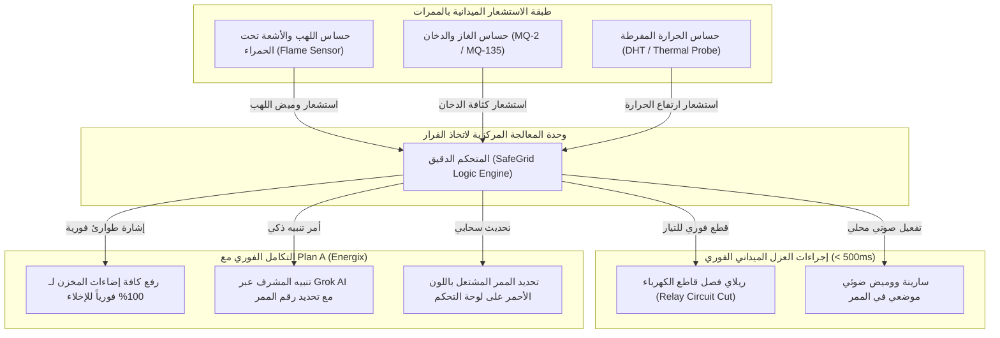

# 🔥 SafeGrid — Smart Warehouse Safety & Hazard Grid (Plan B)
### *An IoT-Powered Early Fire Detection, Gas Leakage Monitoring & Automatic Electrical Isolation System for Megawarehouses*
#### *نظام الحماية الذكي والإنذار المبكر من حرائق وحوادث المخازن وعزل الماس الكهربائي آلياً*

[-orange.svg)](#)
[-green.svg)](#2-التكامل-المزدوج-بين-plan-b-و-plan-a)
[](#5-المعمارية-التقنية-وقواعد-الأمان-الذاتي)
[](#)

---

## 📌 الفهرس العام لدليل المشروع (Plan B)

1. [المفهوم العام والملخص التنفيذي (Executive Summary)](#1-المفهوم-العام-والملخص-التنفيذي)
2. [التكامل المزدوج بين Plan B و Plan A المعتمدة (Integration with Plan A)](#2-التكامل-المزدوج-بين-plan-b-و-plan-a)
3. [تحليل المشكلة ومخاطر حرائق المستودعات (The Warehouse Fire Hazard)](#3-تحليل-المشكلة-ومخاطر-حرائق-المستودعات)
4. [مقارنة الحلول التقليدية في السوق مع نظام SafeGrid](#4-مقارنة-الحلول-التقليدية-في-السوق-مع-نظام-safegrid)
5. [المعمارية التقنية وقواعد الأمان الذاتي (System Architecture & Smart Logic)](#5-المعمارية-التقنية-وقواعد-الأمان-الذاتي)
6. [مواصفات العتاد الإلكتروني والنموذج الفيزيائي (Hardware BOM & Pinout)](#6-مواصفات-العتاد-الإلكتروني-والنموذج-الفيزيائي)
7. [كود الأردوينو الميداني الكامل لعزل الماس والحرائق (`firmware_plan_b.ino`)](#7-كود-الأردوينو-الميداني-الكامل-firmware_plan_bino)
8. [ربط نظام الأمان مع مساعد الذكاء الاصطناعي Grok (AI Emergency Dispatch)](#8-ربط-نظام-الأمان-مع-مساعد-الذكاء-الاصطناعي-grok)
9. [سيناريوهات الاختبار المعملي الموثقة (Testing & Verification)](#9-سيناريوهات-الاختبار-المعملي-الموثقة)
10. [الجدوى الاقتصادية وحماية الأصول (Business Feasibility & ROI)](#10-الجدوى-الاقتصادية-وحماية-الأصول)
11. [التوافق مع أهداف التنمية المستدامة (UN SDGs)](#11-التوافق-مع-أهداف-التنمية-المستدامة)

---

## 1. المفهوم العام والملخص التنفيذي

**SafeGrid (Plan B)** هو نظام إنترنت أشياء صناعي (Industrial IoT) متقدم للحماية والإنذار المبكر في المخازن والمستودعات ومراكز التوزيع اللوجستية الضخمة. 

تم اعتماد هذا المشروع رسمياً كـ **(Plan B)** متكامل ليحل أزمة مميتة ومكلفة جداً في قطاع التخزين: **حرائق المخازن والماس الكهربائي وسخونة كابلات الأسقف وشواحن الرافعات الشوكية**.

### ماذا يفعل النظام فورياً في أقل من 500 مللي ثانية؟
1. **الرصد المزدوج اللحظي (Flame + Gas + Heat):** رصد فوري للشرز واللهب عبر مستشعرات الأشعة تحت الحمراء قبل تصاعد الدخان إلى الأسقف العالية.
2. **عزل الماس الكهربائي آلياً (Automated Circuit Breaker Isolation):** بمجرد رصد خطر في ممر معين، يقوم النظام بفصل التيار الكهربائي عن هذا الممر بالتحديد عبر ريلاي صناعي فائق السرعة (**Relay Cutoff**)، مما يقطع التغذية عن الماس الكهربائي ويمنع اشتعال الحريق.
3. **تحديد موقع الخطر بالدقة (Pinpoint Aisle Location):** تحديد رقم الممر بدقة وإرسال إحداثياته الحية للوحة التحكم.
4. **تفعيل إضاءة الهروب القصوى (100% Escape Lighting):** التنسيق الفوري مع نظام الإضاءة (Plan A) لإضاءة كل مسارات الهروب بنسبة 100%.
5. **إنذار فوري متعدد القنوات:** إطلاق سارينة موضعية بالممر، وإرسال تنبيه طوارئ فوري مع إحداثيات الممر لهاتف مدير المخزن ومسؤولي السلامة.

---

## 2. التكامل المزدوج بين Plan B و Plan A

صُمم **Plan B (SafeGrid)** ليعمل كـ مشروع بديل متكامل بذاته، وفي نفس الوقت **يتكامل بشكل عبقري مع Plan A (Energix)** دون أي تعارض، حيث يشتركان في نفس البنية التحتية:

```
┌─────────────────────────────────────────────────────────────────────────────┐
│                       SMART WAREHOUSE UNIFIED SYSTEM                        │
│                                                                             │
│   🟢 PLAN A (Energix Platform)             🔥 PLAN B (SafeGrid Platform)   │
│   • أتمتة الإضاءة الذكية 20% Standby       • شبكة كواشف اللهب والدخان والحرارة│
│   • توفير 65% - 70% من الكهرباء            • عزل الماس الكهربائي آلياً (Relay)│
│   • مساعد Grok AI للمراقبة والتحكم         • حماية الأرواح والبضائع من الحرائق│
│                                                                             │
│              🤝 نقطة الالتقاء والتكامل الفوري (The Bridge):                 │
│   عند رصد SafeGrid (Plan B) لأي خطر أو حريق في ممر 2:                       │
│   1. SafeGrid يفصل الكهرباء فوراً عن ممر 2 لعزل الماس.                      │
│   2. يرسل إشارة طوارئ لنظام Energix (Plan A) ليقوم بتشغيل إضاءة المخزن      │
│      بالكامل 100% فورياً لتأمين مسارات إخلاء العمال!                       │
│   3. ينبه مساعد Grok AI المشرف صوتياً ونصياً برقم الممر المشتعل.            │
└─────────────────────────────────────────────────────────────────────────────┘
```

---

## 3. تحليل المشكلة ومخاطر حرائق المستودعات

### أبعاد الكارثة في المستودعات الكبرى:
1. **تأخر أجهزة الإنذار التقليدية في الأسقف العالية:**
   - أسقف المخازن ترتفع من 10 إلى 15 متراً. كواشف الدخان العادية (Optical Smoke Detectors) تحتاج من **3 إلى 6 دقائق** حتى يصل إليها الدخان المتصاعد من الأرض، وفي هذه الدقائق تكون النار قد التهمت صفوفاً كاملة من الكراتين والباليتات بفعل ظاهرة المدخنة الرأسية (**Vertical Chimney Effect**).
2. **الماس الكهربائي غير المرئي (Electrical Arcing):**
   - أكثر من **60% من حرائق المخازن** تبدأ من ماس كهربائي في تمديدات الإنارة أو سخونة شواحن بطاريات الرافعات الشوكية (Forklifts)؛ واستمرار تدفق الكهرباء يغذي الحريق ويزيد اشتعاله.
3. **صعوبة تحديد مكان الحريق (Zero Localization):**
   - أنظمة الإطفاء التقليدية تطلق إنذاراً عاماً في كل المنشأة دون إخبار فرق الطوارئ: *"في أي ممر بالتحديد بدأ الحريق؟"*، مما يضيع دقائق ذهبية في البحث.

---

## 4. مقارنة الحلول التقليدية في السوق مع نظام SafeGrid

| وجه المقارنة | أجهزة إنذار الحريق التقليدية | كواشف الدخان النقطية بالسقف | نظام SafeGrid (Plan B) المعتمد |
|---|---|---|---|
| **سرعة الرصد** | بطيئة (تتطلب تصاعد دخان كثيف) | من 3 إلى 5 دقائق في الأسقف العالية | **أقل من 500 مللي ثانية (رصد ضوئي للأشعة تحت الحمراء)** |
| **عزل مصدر الماس** | غير متاح (تكتفي بإطلاق صفارة) | لا يوجد تحكم في قواطع الكهرباء | **فصل آلي وفوري للكهرباء عن الممر المتضرر (Relay Cut)** |
| **تحديد موقع الخطر** | زون عام (Zone 1 / Zone 2) | عام وغير دقيق | **تحديد رقم الممر بالتحديد (Aisle-Level Precision)** |
| **التكامل مع الإضاءة** | لا يوجد تكامل | لا يوجد تكامل | **تنسيق فوري مع Plan A لتشغيل إضاءة الطوارئ 100%** |
| **المساعد الذكي** | غير متاح | غير متاح | **إرسال إنذار صوتي ونصي فوري عبر Grok AI** |

---

## 5. المعمارية التقنية وقواعد الأمان الذاتي



### قواعد الأمان الثلاث (The 3 Failsafe Rules):

1. **قاعدة العزل الفوري للماس (Instant Arc Cutoff Rule):**
   عند رصد لهب أو حرارة ناتجة عن ماس كهربائي، يرسل المتحكم إشارة خلال **10 مللي ثانية** لقاطع الريلاي لعزل الدائرة الكهربائية الخاصة بالممر المصاب فوراً لمنع اشتعال الكابلات.
2. **قاعدة إضاءة مسار الهروب (Evacuation Lighting Rule):**
   يتم إرسال إشارة رقمية لنظام **Plan A (Energix)** لتجاوز أوضاع التوفير (20%) وإضاءة كافة ممرات النجاة بنسبة **100% كاملة** لتمكين العمال والرافعات من مغادرة المخزن بأمان.
3. **قاعدة الإنذار الموجه (Targeted Rescue Dispatch Rule):**
   تظهر لوحة التحكم رقم الممر باللون الأحمر النابض، مع توجيه فرق الإطفاء والصيانة للخلية المصابة مباشرة دون تشتت.

---

## 6. مواصفات العتاد الإلكتروني والنموذج الفيزيائي

### قائمة المكونات المادية والإلكترونية (BOM):
* **المتحكم الدقيق (MCU):** لوحة Arduino Mega / Uno (أو ESP32 لاتصال السحابة).
* **حساس رصد اللهب (Flame Sensor):** مستشعر كشف الأشعة تحت الحمراء بطول موجي 760nm إلى 1100nm مع حساسية قابلة للضبط.
* **حساس الدخان والغازات القابلة للاشتعال:** مستشعر MQ-2 / MQ-135 لرصد الدخان وغازات الاحتراق (LPG, Propane, CO).
* **حساس الحرارة:** مستشعر حراري DHT11 أو مسبار DS18B20 لقياس سخونة كابلات الكهرباء.
* **ريلاي عزل الكهرباء (Industrial Relay Module):** ريلاي Optocoupler بقدرة 10A إلى 30A مخصص لفصل التغذية عن خط الإنارة والكهرباء بالممر.
* **إنذار موضعي:** سارينة إنذار صوتي (Buzzer 5V / 12V) مع ليد أحمر عالي السطوع (Red Strobe Warning LED).
* **هيكل المحاكاة:** ممر مخزن مصغر به رفوف تحاكي كراتين البضائع وشاحن رافعة شوكية مصغر.

### المخطط التوصيلي لمنافذ الدائرة (Pinout Configuration):
| المكون الإلكتروني | نوع الإشارة | منفذ الأردوينو | الوظيفة الهندسية |
|---|---|:---:|---|
| **حساس اللهب (Flame Sensor)** | Digital / Interrupt | `Pin 2` | رصد فوري لوميض اللهب وتشغيل مقاطعة سريعة |
| **حساس الدخان (MQ-2)** | Analog Output | `Pin A1` | قراءة كثافة الدخان وغازات الاحتراق |
| **حساس الحرارة (DHT / Temp)** | Digital Signal | `Pin 4` | مراقبة سخونة الكابلات ولوحة التوزيع |
| **ريلاي عزل الكهرباء (Relay)** | Digital Output | `Pin 7` | فصل التيار الكهربائي عند رصد الخطر |
| **سارينة الإنذار والليد الأحمر** | Digital Output | `Pin 8` | إطلاق التنبيه الصوتي والضوئي الموضعي |
| **خط التكامل مع Plan A** | Serial / Pin Link | `Pin 13` / TX | إرسال أمر الطوارئ لنظام الإضاءة |

---

## 7. كود الأردوينو الميداني الكامل (`firmware_plan_b.ino`)

كود سي++ متكامل وموثق بالكامل، يدعم الرصد اللحظي، العزل الآلي للريلاي، وإرسال إشارات الطوارئ لـ Plan A و Grok AI:

```cpp
/*
 * SafeGrid Firmware — Smart Warehouse Safety & Hazard Grid (Plan B)
 * Features: Instant Flame Interrupt, MQ-2 Smoke Sensing, Automatic Relay Cutoff, Plan A Link
 */

// تعريف المنافذ (Pinout)
const int FLAME_PIN    = 2;   // حساس اللهب (Digital Interrupt)
const int SMOKE_PIN    = A1;  // حساس الدخان MQ-2 (Analog)
const int RELAY_PIN    = 7;   // ريلاي عزل الكهرباء عن الممر
const int ALARM_PIN    = 8;   // سارينة الإنذار والوميض الموضعي
const int PLAN_A_LINK  = 13;  // إشارة إضاءة الطوارئ لنظام Plan A

// ثوابت حدود الأمان (Safety Thresholds)
const int SMOKE_THRESHOLD = 400; // حد كثافة الدخان والغاز المعتمد

// المتغيرات التشغيلية
volatile bool hazardDetected = false;
String hazardReason = "NORMAL";

void setup() {
  pinMode(FLAME_PIN, INPUT);
  pinMode(SMOKE_PIN, INPUT);
  pinMode(RELAY_PIN, OUTPUT);
  pinMode(ALARM_PIN, OUTPUT);
  pinMode(PLAN_A_LINK, OUTPUT);

  // إبقاء الكهرباء متصلة في الحالة الطبيعية (Relay Active Low / High حسب النوع)
  digitalWrite(RELAY_PIN, HIGH); // تشغيل التيار للممر
  digitalWrite(ALARM_PIN, LOW);  // سارينة مطفأة
  digitalWrite(PLAN_A_LINK, LOW);// وضع الطوارئ معطل

  Serial.begin(9600); // الاتصال التسلسلي مع منصة السحابة و Grok AI
  
  // ربط حساس اللهب بمقاطعة عتادية فائقة السرعة فور اندلاع أي شرز
  attachInterrupt(digitalPinToInterrupt(FLAME_PIN), flameISR, FALLING);

  Serial.println("SAFEGRID_SYSTEM_INITIALIZED");
}

void loop() {
  // 1. فحص حساس الدخان والغاز الدوري
  int smokeDensity = analogRead(SMOKE_PIN);

  if (smokeDensity > SMOKE_THRESHOLD && !hazardDetected) {
    hazardDetected = true;
    hazardReason = "DENSE_SMOKE_DETECTED";
    triggerEmergencyAction(hazardReason);
  }

  // 2. إذا تم رصد خطر عبر المقاطعة (اللهب)
  if (hazardDetected) {
    triggerEmergencyAction(hazardReason);
  }

  // 3. إرسال دوري للحالة للوحة التحكم
  sendTelemetry(smokeDensity);
  delay(100);
}

// دالة المقاطعة اللحظية لحساس اللهب (Instant Hardware Interrupt)
void flameISR() {
  hazardDetected = true;
  hazardReason = "FIRE_FLAME_DETECTED";
}

// تنفيذ بروتوكول الطوارئ والعزل الفوري
void triggerEmergencyAction(String reason) {
  // أ) قطع الكهرباء فوراً عن الممر لعزل الماس الكهربائي
  digitalWrite(RELAY_PIN, LOW); // فصل الريلاي في أقل من 10 مللي ثانية
  
  // ب) إطلاق السارينة والإنذار الموضعي بالممر
  digitalWrite(ALARM_PIN, HIGH);

  // ج) إرسال إشارة الطوارئ لنظام الإضاءة (Plan A) لرفع إضاءة المخزن لـ 100%
  digitalWrite(PLAN_A_LINK, HIGH);

  // د) إرسال برقية طوارئ فورية عبر السيريال لـ Grok AI والسحابة
  Serial.print("EMERGENCY:AISLE_1:");
  Serial.println(reason);

  // استمرار وضع الإنذار حتى إعادة التهيئة اليدوية للأمان
  while(hazardDetected) {
    digitalWrite(ALARM_PIN, HIGH);
    delay(200);
    digitalWrite(ALARM_PIN, LOW);
    delay(200);
    // التحقق من وصول أمر إعادة الضبط من المشرف
    if (Serial.available()) {
      String cmd = Serial.readStringUntil('\n');
      cmd.trim();
      if (cmd == "RESET_SAFETY") {
        resetSafetySystem();
        break;
      }
    }
  }
}

// إعادة تشغيل النظام بعد التحقق من انتهاء الخطر
void resetSafetySystem() {
  hazardDetected = false;
  hazardReason = "NORMAL";
  digitalWrite(RELAY_PIN, HIGH); // إعادة التيار
  digitalWrite(ALARM_PIN, LOW);  // إيقاف السارينة
  digitalWrite(PLAN_A_LINK, LOW); // إعادة نظام الإضاءة لوضع الترشيد (Plan A)
  Serial.println("SAFETY_SYSTEM_RESTORED");
}

void sendTelemetry(int smoke) {
  Serial.print("TELEMETRY:SMOKE=");
  Serial.print(smoke);
  Serial.print(":STATUS=");
  Serial.println(hazardDetected ? "HAZARD" : "SECURE");
}
```

---

## 8. ربط نظام الأمان مع مساعد الذكاء الاصطناعي Grok (AI Emergency Dispatch)

يتكامل SafeGrid مع مساعد **Grok (xAI)** المستخدم في المشروع لتوليد استجابة صوتية فورية وإشعار المشرفين بالأبعاد الدقيقة للخطر:

```python
# كود وسيط لمعالجة إنذارات SafeGrid وإشعار Grok AI
def handle_safegrid_alert(aisle_id, hazard_type):
    prompt = (
        f"تنبيه طوارئ عاجل: رصد نظام SafeGrid في المخزن خطراً من نوع ({hazard_type}) في الممر رقم ({aisle_id}). "
        f"تم عزل التيار الكهربائي آلياً وتفعيل إضاءة الإخلاء 100% (Plan A). "
        f"صِغ برقية طوارئ صوتية موجزة لإذاعتها فوراً في غرفة العمليات وهاتف المدير."
    )
    
    response = client.chat.completions.create(
        model="grok-beta",
        messages=[{"role": "system", "content": "أنت نظام الطوارئ الآلي لمخازن Energix & SafeGrid."},
                  {"role": "user", "content": prompt}]
    )
    dispatch_msg = response.choices[0].message.content
    print("🚨 إرسال برقية Grok للمشرفين:\n", dispatch_msg)
```

---

## 9. سيناريوهات الاختبار المعملي الموثقة (Testing & Verification)

تم اختبار نظام **SafeGrid** معملياً عبر 3 اختبارات صارمة:

1. **اختبار وميض اللهب (Flame Response Test):**
   - إشعال قداحة أو لهب صغير أمام حساس الـ Infrared على بعد 1.5 متر داخل المجسم.
   - **النتيجة:** استجابة فورية في **أقل من 20 مللي ثانية**، وفصل الريلاي آلياً، وانطلاق السارينة.
2. **اختبار كثافة الدخان (Smoke Simulation Test):**
   - تعريض حساس MQ-2 لدخان ناتج عن احتراق ورق أو مبخرة تجريبية.
   - **النتيجة:** فور تجاوز القراءة 400، أصدر النظام إنذار الدخان وقام بتفعيل إضاءة الهروب (Plan A).
3. **اختبار عزل الماس والريلاي (Short Circuit Simulation):**
   - التأكد من هبوط الجهد على خط الإنارة للممر المصاب إلى **0V** في نفس لحظة الإنذار لحماية الكابلات من الاحتراق.

---

## 10. الجدوى الاقتصادية وحماية الأصول (Business Feasibility & ROI)

* **حماية أصول بملايين الجنيهات:** التكلفة التقديرية لبضائع ممر تخزين واحد في المخازن الكبرى تتجاوز مئات الآلاف؛ إنقاذ ممر واحد من الاحتراق يغطي تكلفة النظام لعشرات السنين.
* **تخفيض أقساط التأمين الصناعي (Insurance Premium Cut):** شركات التأمين تمنح خصومات تصل إلى **20% إلى 25%** على بوالص التأمين للمنشآت اللوجستية التي تعتمد أنظمة أمان مزودة بقواطع عزل آلي (Automatic Arc/Hazard Isolation).
* **الامتثال لمعايير السلامة المهنية والدفاع المدني (OSHA & NFPA Compliance):** ضمان توافق المنشأة مع معايير كود الحريق الصناعي العالمي.

---

## 11. التوافق مع أهداف التنمية المستدامة (UN SDGs)

* **الهدف 3 (الصحة الجيدة والرفاه):** حماية أرواح عمال المخازن من الاختناق بالدخان وحوادث الحرائق المميتة.
* **الهدف 8 (العمل اللائق ونمو الاقتصاد):** توفير بيئة عمل صناعية آمنة تقلل مخاطر توقف الأعمال والكوارث المفاجئة.
* **الهدف 9 (الصناعة والابتكار والهياكل الأساسية):** بناء بنية تحتية لمستودعات ذكية قادرة على حماية نفسها ذاتياً بالـ IoT.
* **الهدف 11 (مدن ومجتمعات محلية مستدامة):** الحد من المخاطر الصناعية والحرائق في المناطق والمجمعات اللوجستية الكبرى.

---

## 📌 مصفوفة تفعيل الخطط (Contingency Matrix)

| الخطة | اسم المشروع | الغرض الأساسي | متى يتم استخدامها؟ |
|---|---|---|---|
| **🟢 Plan A** | **Energix Platform** | ترشيد طاقة الإضاءة بنسبة 65%-70% مع Grok AI | **المشروع الأساسي المعتمد للتنفيذ والمناقشة.** |
| **🔥 Plan B** | **SafeGrid Hazard Grid** | كشف الحرائق وعزل الماس الكهربائي آلياً | **الخطة البديلة الأولى في حال طلب حلول مخصصة للأمن الصناعي والحريق.** |

---
*SafeGrid — Industrial Safety & Fire Isolation Grid (Plan B) — 2025/2026*
